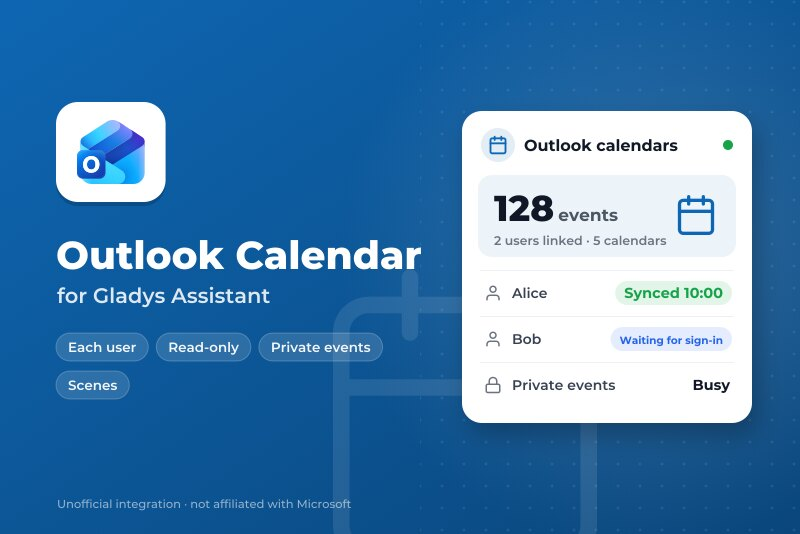
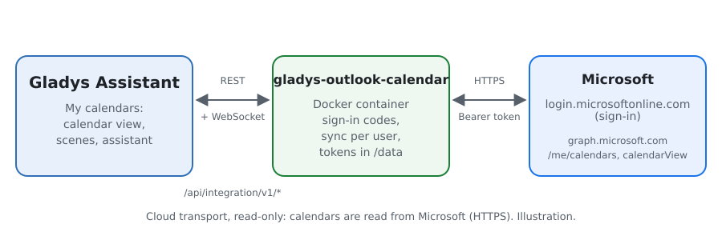
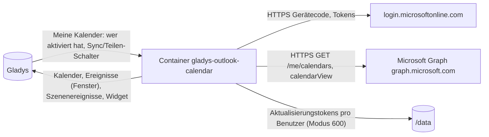
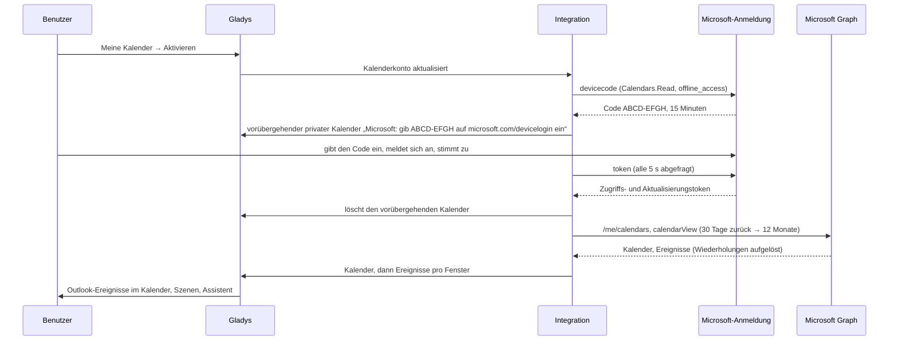
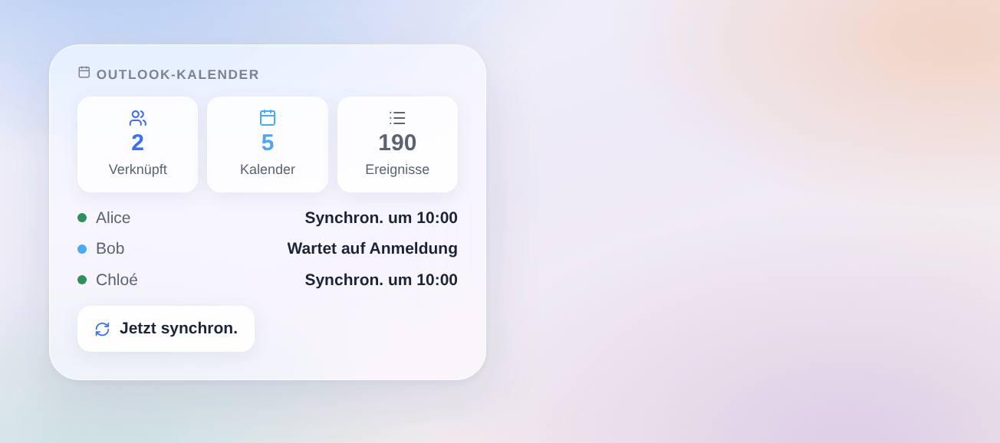

# Gladys Outlook Calendar

[English](README.md) · [Français](README.fr.md) · **Deutsch** · [Español](README.es.md)

[](LICENSE)
[](https://github.com/William-De71/gladys-outlook-calendar/releases)
[](https://github.com/William-De71/gladys-outlook-calendar/actions/workflows/release.yml)
[](https://gladysassistant.com)



Externe Integration vom Typ **Kalender** für [Gladys Assistant](https://gladysassistant.com), die die **Outlook-Kalender** jedes Gladys-Benutzers synchron hält — Outlook.com, Hotmail oder Microsoft 365 — über Microsoft Graph, nur lesend. Jeder Benutzer verknüpft sein eigenes Microsoft-Konto; seine Ereignisse leben dann im Kalender von Gladys, starten Szenen und versorgen den Assistenten.

Benutzerdokumentation: [English](docs/en.md) · [Français](docs/fr.md) · [Deutsch](docs/de.md) · [Español](docs/es.md).

Nicht mit Microsoft verbunden. **Noch nicht mit einem echten Microsoft-Konto getestet**: Die Anfragen folgen den offiziellen Referenzen von Microsoft Graph und der Identitätsplattform, und die Tests laufen gegen ein gefälschtes Microsoft. Rückmeldungen sind willkommen.

## Funktionen

- **Kalenderanbieter** (`type: "calendar"`, Gladys 5.3+): ein Gladys-Kalender pro Outlook-Kalender jedes Benutzers, privat, bis er ihn teilt; mit ihm geteilte Kalender inklusive.
- **Jeder sein eigenes Konto**: Anmeldung pro Benutzer mit einem Code (Device-Code-Flow), angezeigt in einem eigenen vorübergehenden Kalender; Aktualisierungstokens pro Benutzer, erneuert und rotiert.
- **Ereignisse**: 30 Tage zurück bis 3, 6 oder 12 Monate voraus, Wiederholungen aufgelöst, ganztägige Ereignisse nach Datum, Ort, Notizen, Link zur Online-Besprechung; in Outlook gelöschte Ereignisse verschwinden.
- **Privatsphäre**: private Ereignisse als „Beschäftigt“ (oder mit Details, oder weggelassen), abgelehnte Einladungen weggelassen, nur lesende Berechtigungen (`Calendars.Read`, `User.Read`, `offline_access`).
- **Szenenauslöser**: Ein Benutzer muss sich anmelden, hat sich angemeldet, Synchronisierung schlägt fehl, geht wieder; **Szenenaktion** „jetzt synchronisieren“.
- **Dashboard-Widget**: verknüpfte Benutzer, Kalender und Ereignisse, der Zustand jedes Benutzers, eine Sync-Taste.
- Schaltflächen **App-Registrierung prüfen** und **Jetzt synchronisieren**. Englisch, Französisch, Deutsch und Spanisch.

## Funktionsweise





Einen Benutzer verknüpfen, von „Meine Kalender“ bis zu den Ereignissen:



Alle 15 Minuten (5 bis 60) werden die Kalender jedes verknüpften Benutzers erneut gelesen; ein Kalender, dessen Ereignisse sich nicht geändert haben, wird nicht erneut gesendet, und die Schreibvorgänge an Gladys werden gestaffelt (der Kern erlaubt 30 pro Minute). Mehr als 500 Ereignisse in einem Fenster werden in getrennte Fenster aufgeteilt, ein Ereignis über eine Grenze hinweg in jedem.

**Warum ein vorübergehender Kalender**: Gladys bietet für Kalenderintegrationen noch keine „Verbinden“-Schaltfläche pro Benutzer, und der Verbindungsstatus ist nur für Administratoren sichtbar. Die eigene Kalenderliste des Benutzers ist der einzige private Ort, um ihm seinen Code zu geben.

### Transport

`transports: ["cloud"]`: Alles geht per HTTPS an `login.microsoftonline.com` und `graph.microsoft.com`. Die Integration liest nur: Gladys schreibt nie in Outlook. `/data` enthält ein Aktualisierungstoken pro Benutzer (Datei im Modus 600, nie protokolliert); die Zugriffstokens bleiben im Speicher.

## Ein Konto verknüpfen

| Schritt                      | Wer            | Wo                                                                      |
| ---------------------------- | -------------- | ----------------------------------------------------------------------- |
| App-Registrierung (einmalig) | Administrator  | Microsoft Entra: öffentlicher Client, alle Kontotypen, `Calendars.Read` |
| Anwendungs-ID                | Administrator  | Konfiguration der Integration, dann **App-Registrierung prüfen**        |
| Aktivieren                   | Jeder Benutzer | Block **Meine Kalender** der Konfigurationsseite                        |
| Code eingeben                | Jeder Benutzer | microsoft.com/devicelogin, der Code aus dem vorübergehenden Kalender    |

Der Code wird eine Stunde lang von selbst erneuert (4-mal); danach gibt erneutes Speichern von „Meine Kalender“ einen neuen. Eine widerrufene Anmeldung (Passwort geändert, 90 Tage ungenutzt) bringt den vorübergehenden Kalender zurück.

## Szenen und Widget



- **Auslöser „Outlook: Ein Benutzer muss sich anmelden“**: Variablen `user`, `first_name`, `reason` (`new`, `revoked`); Filter nach Grund.
- **Auslöser „Outlook: Ein Benutzer hat sich angemeldet“**: Variablen `user`, `first_name`, `account`.
- **Auslöser „Outlook: Synchronisierung schlägt fehl“**: Variablen `user`, `first_name`, `kind` (`app`, `forbidden`, `not_found`, `throttled`, `unreachable`, `server`), `message`; einmal pro Ausfall und Benutzer.
- **Auslöser „Outlook: Synchronisierung geht wieder“**: Variablen `user`, `first_name`, `down_minutes`.
- **Aktion „Outlook: jetzt synchronisieren“**: Ausgaben `users`, `events`.
- **Widget „Outlook-Kalender“**: nur Vornamen und Zustände, nie eine E-Mail oder ein Ereignis (ein Dashboard sieht der ganze Haushalt).
- Die Ereignisse selbst starten Szenen mit dem Gladys-Auslöser „ein Kalenderereignis steht bevor“, bei geteilten Kalendern.

Beispiele:

- _Wenn ein Benutzer sich erneut anmelden muss_ (Grund `revoked`) → eine Telegram-Nachricht an `{{triggerEvent.data.first_name}}` schicken.
- _Jeden Morgen um 7:00_ → Outlook: jetzt synchronisieren, dann die heutigen Ereignisse vorlesen.

## Voraussetzungen

- Gladys Assistant **5.3.0** oder neuer (Kalenderintegrationen); ältere Instanzen können die Integration nicht installieren.
- Ein Microsoft-Konto pro Benutzer (persönlich oder geschäftlich) und eine App-Registrierung in Microsoft Entra (kostenlos).

### Grenzen

- Microsoft Graph drosselt pro Benutzer und pro App; ein 429 wartet so lange, wie `Retry-After` verlangt (höchstens 30 s), dann schlägt die Synchronisierung dieses Benutzers einmal fehl und der Auslöser wird ausgelöst.
- 50 Kalender pro Benutzer und 10.000 Ereignisse pro Kalender in Gladys.
- Ein Geschäftskonto kann verlangen, dass ein Administrator der Firma die App genehmigt (Administratorzustimmung).

## Installation

- **Aus dem Store**: Integrationen → Outlook Calendar → Installieren.
- **Über die URL des Repositorys**: Integrationen → externe Integration → `https://github.com/William-De71/gladys-outlook-calendar`.
- **Entwicklermodus**: Starte `npm start` mit den von Gladys gegebenen Variablen (siehe Entwicklung).

## Konfiguration

| Feld oder Schaltfläche                | Standard    | Bedeutung                                                                  |
| ------------------------------------- | ----------- | -------------------------------------------------------------------------- |
| Anwendungs-ID (Client)                | —           | Pflichtfeld: die App-Registrierung in Microsoft Entra                      |
| Mandant (Tenant)                      | common      | `common`, `consumers`, `organizations` oder eine Mandanten-ID oder -Domain |
| Synchronisieren alle                  | 15 Min.     | 5, 15, 30 Minuten oder 1 Stunde                                            |
| Ereignisse voraus                     | 12 Monate   | 3, 6 oder 12 Monate; 30 Tage zurück bleiben                                |
| Private Ereignisse (pro Benutzer)     | Beschäftigt | Beschäftigt, angezeigt oder weggelassen                                    |
| Abgelehnte Einladungen (pro Benutzer) | Weggelassen | Weggelassen oder angezeigt                                                 |
| App-Registrierung prüfen              | —           | Fragt Microsoft mit der App nach einem Code (verworfen)                    |
| Jetzt synchronisieren                 | —           | Liest die Kalender aller verknüpften Benutzer erneut                       |

## Verwendung

1. Lege die App-Registrierung an (siehe [docs/de.md](docs/de.md#die-app-registrierung-anlegen)) und füge ihre ID ein; drücke **App-Registrierung prüfen**.
2. Jeder Benutzer aktiviert **Meine Kalender** und gibt auf microsoft.com/devicelogin den Code aus seinem vorübergehenden Kalender ein.
3. Teile einen Kalender mit dem Haushalt, um seine Ereignisse in Szenen zu nutzen; füge das Widget einem Dashboard hinzu.

## Entwicklung

```bash
npm install
npm test                       # node --test, ein gefälschtes Microsoft auf 127.0.0.1, nie das Netzwerk
npm run lint                   # ESLint
npm run format:check           # Prettier
npx github:GladysAssistant/integration-store . --skip-image-check
scripts/build-cover.sh         # cover.jpg aus docs/assets/cover.svg
docs/illustrations/render.sh   # docs/assets/widgets.<lang>.png
```

Lokal liest das SDK `GLADYS_HOST_API_URL`, `GLADYS_INTEGRATION_TOKEN` und `GLADYS_INTEGRATION_SELECTOR` (von Gladys im Entwicklermodus vorgegeben), und die Integration liest `TZ`. `DEBUG=gladys-integration-sdk` zeigt die Protokolle des SDK.

Die Tests decken die Anmeldung ab (Gerätecode, Abfrage, Verlangsamung, Ablehnung, Ablauf und Erneuerung, Token-Rotation, Widerruf), Graph (Seiten, `Retry-After`, ein einmal erneuerter 401), die Umwandlung (IDs, Farben, ganztägige Daten, private und abgelehnte Ereignisse, Links), die Fensteraufteilung, die Auslöser, das Widget (`validateWidgetContent`), das Manifest, die vier Sprachen, das Release-Skript und die ganze Integration gegen das gefälschte Gladys des SDK. `test/structure.test.js` friert jeden von Benutzern gespeicherten Schlüssel ein.

## Release-Prozess


Jeder Merge auf `main` startet die CI und berechnet dann die Version aus den [Conventional Commits](https://www.conventionalcommits.org/) seit dem letzten Tag: `feat` → Minor, `fix` / `perf` → Patch, `!` oder `BREAKING CHANGE` → Major (ein Minor unter 1.0.0); `docs`, `chore`, `ci`, `test`, `style`, `refactor`, `build` allein veröffentlichen nichts. Der Changelog-Abschnitt wird erzeugt, der Tag gepusht, das Multi-Architektur-Image gebaut, dann erhält `main` den Release-Commit, das GitHub Release wird erstellt und ein letzter Job prüft das öffentliche Image, den Validator des Stores und das Topic.

- Der Titel des Pull Requests wird zum Squash-Commit und dann zur Changelog-Zeile: Schreibe ihn auf Englisch, für den Benutzer (`pr-title.yml` prüft ihn). Bearbeite `CHANGELOG.md` nie von Hand.
- 1.0.0 ist eine Entscheidung: Actions → Release → Run workflow mit `release-as: 1.0.0`. `dry-run` zeigt Version und Notizen, ohne zu veröffentlichen.
- **Geschützter Branch**: Das Release pusht seinen Commit mit `GITHUB_TOKEN` auf `main`. Das Ruleset `protect-main` (kein Löschen, kein Force-Push) lässt es durch; eine strengere Regel (Pull Request Pflicht, Status-Checks) bräuchte GitHub Actions in der Ausnahmeliste oder eine GitHub App.
- Mache nach dem ersten Release das Paket auf `ghcr.io` öffentlich (Package settings → Change visibility), sonst kann Gladys es nicht herunterladen.

## Fehlerbehebung

Siehe [docs/de.md](docs/de.md#fehlerbehebung). Melde Probleme mit den Versionen von Gladys und der Integration, dem Kontotyp (persönlich oder geschäftlich), dem Mandanten, dem AADSTS-Code, falls vorhanden, und der Meldung von **App-Registrierung prüfen**. Füge niemals einen Code oder ein Token ein.

## Mitwirken

Issues und Pull Requests sind willkommen, vor allem von Leuten mit einem geschäftlichen Microsoft-365-Konto: Administratorzustimmung und geteilte Kalender sind die am wenigsten getesteten Wege. Führe vor einem Pull Request `npm run format:check && npm run lint && npm test` aus und lass jeden gespeicherten Schlüssel unverändert (siehe [CLAUDE.md](CLAUDE.md)).

## Sicherheit

Siehe [SECURITY.md](SECURITY.md): Melde Sicherheitslücken vertraulich. Aktualisierungstokens liegen in `/data/accounts.json` (Modus 600), Zugriffstokens im Speicher, beide werden nur per HTTPS an Microsoft gesendet; keines wird je protokolliert. Die Berechtigungen sind nur lesend. Der Anmeldecode erscheint nur im privaten Kalender des Benutzers.

## Kommende Screenshots

Die Bilder oben sind Illustrationen, keine Screenshots. Echte Screenshots kommen nach `docs/assets/screenshots/` (PNG, 1280 × 800): `my-calendars.png` (der Block Meine Kalender mit dem vorübergehenden Anmeldekalender), `calendar.png` (Outlook-Ereignisse im Kalender von Gladys), `configuration.png` (die Konfiguration mit App-Registrierung prüfen).

## Lizenz

[Apache License 2.0](LICENSE) — siehe auch [NOTICE](NOTICE). Microsoft, Outlook und Microsoft 365 sind Marken der Microsoft-Unternehmensgruppe; dieses Projekt ist nicht mit Microsoft verbunden und wird von Microsoft weder unterstützt noch gesponsert. Danke an die Dokumentation und das SDK von Gladys sowie an die Dokumentation von Microsoft Graph.
