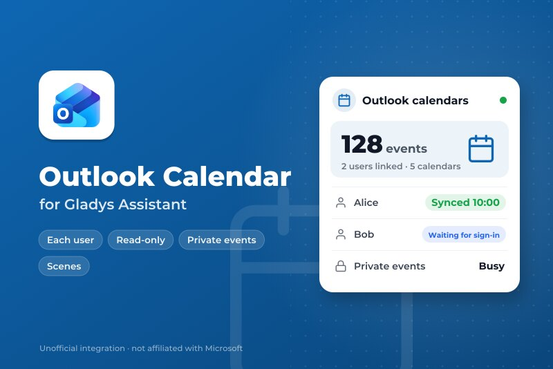
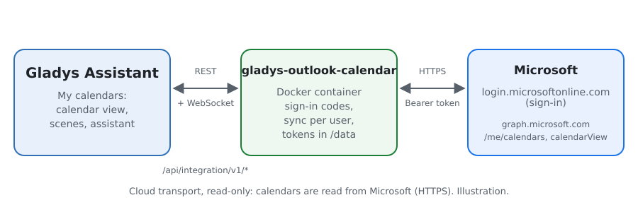
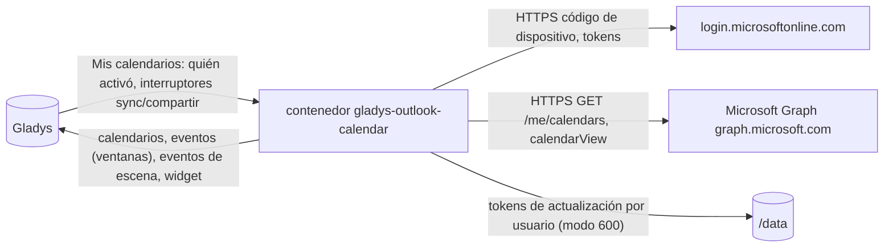
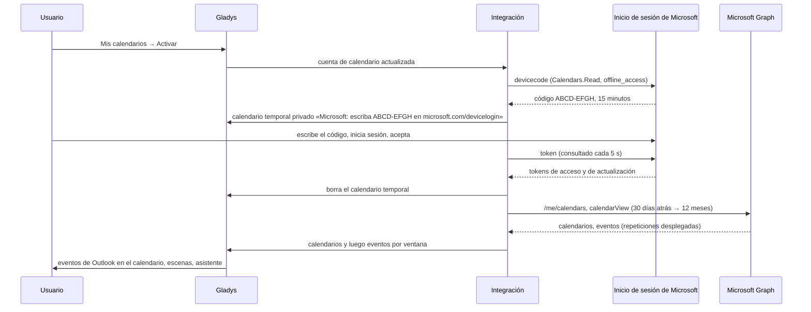
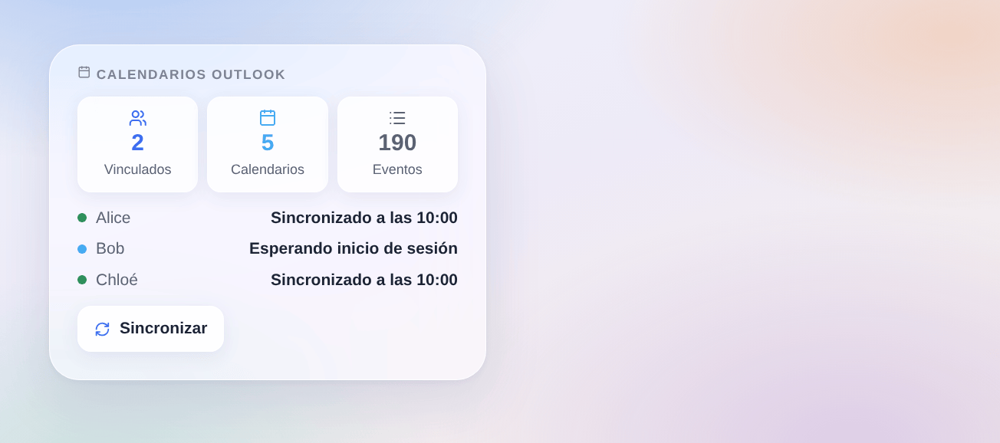

# Gladys Outlook Calendar

[English](README.md) · [Français](README.fr.md) · [Deutsch](README.de.md) · **Español**

[](LICENSE)
[](https://github.com/William-De71/gladys-outlook-calendar/releases)
[](https://github.com/William-De71/gladys-outlook-calendar/actions/workflows/release.yml)
[](https://gladysassistant.com)



Integración externa de tipo **calendario** para [Gladys Assistant](https://gladysassistant.com) que mantiene sincronizados los **calendarios de Outlook** de cada usuario de Gladys — Outlook.com, Hotmail o Microsoft 365 — a través de Microsoft Graph, en solo lectura. Cada usuario vincula su propia cuenta de Microsoft; sus eventos viven entonces en el calendario de Gladys, disparan escenas y alimentan al asistente.

Documentación de usuario: [English](docs/en.md) · [Français](docs/fr.md) · [Deutsch](docs/de.md) · [Español](docs/es.md).

No afiliada a Microsoft. **Todavía no probada con una cuenta real de Microsoft**: las solicitudes siguen las referencias oficiales de Microsoft Graph y de la plataforma de identidad, y las pruebas se ejecutan contra un Microsoft falso. Sus comentarios son bienvenidos.

## Funciones

- **Proveedor de calendarios** (`type: "calendar"`, Gladys 5.3+): un calendario de Gladys por calendario de Outlook de cada usuario, privado hasta que lo comparta; incluidos los calendarios compartidos con él.
- **Cada uno con su cuenta**: inicio de sesión por usuario con un código (flujo de código de dispositivo), mostrado en un calendario temporal propio; tokens de actualización guardados por usuario, renovados y rotados.
- **Eventos**: de 30 días atrás a 3, 6 o 12 meses por delante, repeticiones desplegadas, días completos por fecha, lugar, notas, enlace de reunión en línea; un evento borrado en Outlook desaparece.
- **Privacidad**: eventos privados mostrados como «Ocupado» (o con sus detalles, u omitidos), invitaciones rechazadas omitidas, permisos de solo lectura (`Calendars.Read`, `User.Read`, `offline_access`).
- **Disparadores de escena**: un usuario debe iniciar sesión, ha iniciado sesión, la sincronización falla, vuelve a funcionar; **acción de escena** «sincronizar ahora».
- **Widget del panel**: usuarios vinculados, calendarios y eventos, el estado de cada usuario, un botón de sincronizar.
- Botones **Comprobar el registro de aplicación** y **Sincronizar ahora**. Inglés, francés, alemán y español.

## Funcionamiento





Vincular a un usuario, de «Mis calendarios» a los eventos:



Cada 15 minutos (de 5 a 60) se vuelven a leer los calendarios de cada usuario vinculado; un calendario cuyos eventos no han cambiado no se vuelve a enviar, y las escrituras hacia Gladys se espacian (el núcleo admite 30 por minuto). Más de 500 eventos en una ventana se dividen en ventanas disjuntas, con un evento que cruza un límite en cada una.

**Por qué un calendario temporal**: Gladys aún no ofrece un botón «Conectar» por usuario para las integraciones de calendario, y el estado de conexión solo lo ven los administradores. La propia lista de calendarios del usuario es el único lugar privado para darle su código.

### Transporte

`transports: ["cloud"]`: todo va a `login.microsoftonline.com` y `graph.microsoft.com` por HTTPS. La integración solo lee: Gladys nunca escribe en Outlook. `/data` guarda un token de actualización por usuario (archivo en modo 600, nunca registrado); los tokens de acceso se quedan en memoria.

## Vincular una cuenta

| Paso                             | Quién         | Dónde                                                                          |
| -------------------------------- | ------------- | ------------------------------------------------------------------------------ |
| Registro de aplicación (una vez) | Administrador | Microsoft Entra: cliente público, cualquier tipo de cuenta, `Calendars.Read`   |
| ID de aplicación                 | Administrador | Configuración de la integración, luego **Comprobar el registro de aplicación** |
| Activar                          | Cada usuario  | Bloque **Mis calendarios** de la página Configuración                          |
| Escribir el código               | Cada usuario  | microsoft.com/devicelogin, el código del calendario temporal                   |

El código se renueva solo durante una hora (4 veces); después, guardar de nuevo «Mis calendarios» da uno nuevo. Un inicio de sesión revocado (contraseña cambiada, 90 días sin uso) trae de vuelta el calendario temporal.

## Escenas y widget



- **Disparador «Outlook: un usuario debe iniciar sesión»**: variables `user`, `first_name`, `reason` (`new`, `revoked`); filtro por motivo.
- **Disparador «Outlook: un usuario ha iniciado sesión»**: variables `user`, `first_name`, `account`.
- **Disparador «Outlook: la sincronización falla»**: variables `user`, `first_name`, `kind` (`app`, `forbidden`, `not_found`, `throttled`, `unreachable`, `server`), `message`; una vez por fallo y usuario.
- **Disparador «Outlook: la sincronización vuelve a funcionar»**: variables `user`, `first_name`, `down_minutes`.
- **Acción «Outlook: sincronizar ahora»**: salidas `users`, `events`.
- **Widget «Calendarios Outlook»**: solo nombres y estados, nunca un correo ni un evento (un panel lo ve todo el hogar).
- Los propios eventos disparan escenas con el disparador de Gladys «se acerca un evento del calendario», en los calendarios compartidos.

Ejemplos:

- _Cuando un usuario debe volver a iniciar sesión_ (motivo `revoked`) → enviar un mensaje de Telegram a `{{triggerEvent.data.first_name}}`.
- _Cada mañana a las 7:00_ → Outlook: sincronizar ahora y luego leer en voz alta los eventos del día.

## Requisitos

- Gladys Assistant **5.3.0** o posterior (integraciones de calendario); las instancias más antiguas no pueden instalar la integración.
- Una cuenta de Microsoft por usuario (personal o profesional) y un registro de aplicación en Microsoft Entra (gratuito).

### Límites

- Microsoft Graph limita por usuario y por aplicación; un 429 espera lo que pide `Retry-After` (30 s como máximo), luego la sincronización de ese usuario falla una vez y salta el disparador.
- 50 calendarios por usuario y 10 000 eventos por calendario en Gladys.
- Una cuenta profesional puede exigir que un administrador de la empresa apruebe la aplicación (consentimiento del administrador).

## Instalación

- **Desde la tienda**: Integraciones → Outlook Calendar → Instalar.
- **Desde la URL del repositorio**: Integraciones → integración externa → `https://github.com/William-De71/gladys-outlook-calendar`.
- **Modo desarrollador**: ejecute `npm start` con las variables que da Gladys (ver Desarrollo).

## Configuración

| Campo o botón                         | Por defecto | Función                                                                |
| ------------------------------------- | ----------- | ---------------------------------------------------------------------- |
| ID de aplicación (cliente)            | —           | Obligatorio: el registro de aplicación en Microsoft Entra              |
| Inquilino (tenant)                    | common      | `common`, `consumers`, `organizations`, o un ID o dominio de inquilino |
| Sincronizar cada                      | 15 min      | 5, 15, 30 minutos o 1 hora                                             |
| Eventos por delante                   | 12 meses    | 3, 6 o 12 meses; se conservan 30 días atrás                            |
| Eventos privados (por usuario)        | Ocupado     | Ocupado, mostrados u omitidos                                          |
| Invitaciones rechazadas (por usuario) | Omitidas    | Omitidas o mostradas                                                   |
| Comprobar el registro de aplicación   | —           | Pide un código a Microsoft con la aplicación (descartado)              |
| Sincronizar ahora                     | —           | Vuelve a leer los calendarios de cada usuario vinculado                |

## Uso

1. Cree el registro de aplicación (ver [docs/es.md](docs/es.md#crear-el-registro-de-aplicación)) y pegue su ID; pulse **Comprobar el registro de aplicación**.
2. Cada usuario activa **Mis calendarios** y escribe en microsoft.com/devicelogin el código mostrado en su calendario temporal.
3. Comparta un calendario con el hogar para usar sus eventos en escenas; añada el widget a un panel.

## Desarrollo

```bash
npm install
npm test                       # node --test, un Microsoft falso en 127.0.0.1, nunca la red
npm run lint                   # ESLint
npm run format:check           # Prettier
npx github:GladysAssistant/integration-store . --skip-image-check
scripts/build-cover.sh         # cover.jpg a partir de docs/assets/cover.svg
docs/illustrations/render.sh   # docs/assets/widgets.<lang>.png
```

En local, el SDK lee `GLADYS_HOST_API_URL`, `GLADYS_INTEGRATION_TOKEN` y `GLADYS_INTEGRATION_SELECTOR` (que da Gladys en modo desarrollador), y la integración lee `TZ`. `DEBUG=gladys-integration-sdk` muestra los registros del SDK.

Las pruebas cubren el inicio de sesión (código de dispositivo, consulta, ralentización, rechazo, caducidad y renovación, rotación del token, revocación), Graph (páginas, `Retry-After`, un 401 renovado una vez), la conversión (identificadores, colores, días completos, eventos privados y rechazados, enlaces), la división de ventanas, los disparadores, el widget (`validateWidgetContent`), el manifiesto, los cuatro idiomas, el script de release y toda la integración contra el Gladys falso del SDK. `test/structure.test.js` congela cada clave que guardan los usuarios.

## Proceso de release


Cada fusión en `main` lanza la CI y luego calcula la versión a partir de los [Conventional Commits](https://www.conventionalcommits.org/) desde la última etiqueta: `feat` → menor, `fix` / `perf` → parche, `!` o `BREAKING CHANGE` → mayor (una menor por debajo de 1.0.0); `docs`, `chore`, `ci`, `test`, `style`, `refactor`, `build` solos no publican nada. Se genera la sección del changelog, se sube la etiqueta, se construye la imagen multiarquitectura, luego `main` recibe el commit de release, se crea la GitHub Release y un último job comprueba la imagen pública, el validador de la tienda y el topic.

- El título de la pull request se convierte en el commit squash y luego en la línea del changelog: escríbalo en inglés, para el usuario (`pr-title.yml` lo comprueba). Nunca edite `CHANGELOG.md` a mano.
- 1.0.0 es una decisión: Actions → Release → Run workflow con `release-as: 1.0.0`. `dry-run` muestra la versión y las notas sin publicar nada.
- **Rama protegida**: la release sube su commit a `main` con `GITHUB_TOKEN`. El ruleset `protect-main` (sin borrado ni force-push) lo deja pasar; una regla más estricta (pull request obligatoria, status checks) necesitaría GitHub Actions en la lista de excepciones, o una GitHub App.
- Tras la primera release, haga público el paquete de `ghcr.io` (Package settings → Change visibility), o Gladys no podrá descargarlo.

## Solución de problemas

Ver [docs/es.md](docs/es.md#solución-de-problemas). Informe de los problemas con las versiones de Gladys y de la integración, el tipo de cuenta (personal o profesional), el inquilino, el código AADSTS si lo hay y el mensaje de **Comprobar el registro de aplicación**. Nunca pegue un código ni un token.

## Contribuir

Issues y pull requests bienvenidas, sobre todo de personas con una cuenta profesional de Microsoft 365: el consentimiento del administrador y los calendarios compartidos son los caminos menos probados. Ejecute `npm run format:check && npm run lint && npm test` antes de abrir una pull request, y no cambie ninguna clave guardada (ver [CLAUDE.md](CLAUDE.md)).

## Seguridad

Ver [SECURITY.md](SECURITY.md): informe de las vulnerabilidades en privado. Los tokens de actualización viven en `/data/accounts.json` (modo 600), los tokens de acceso en memoria, ambos enviados solo a Microsoft por HTTPS; ninguno se registra nunca. Los permisos son de solo lectura. El código de inicio de sesión solo se muestra en el calendario privado del usuario.

## Capturas por venir

Las imágenes de arriba son ilustraciones, no capturas. Las capturas reales irán en `docs/assets/screenshots/` (PNG, 1280 × 800): `my-calendars.png` (el bloque Mis calendarios con el calendario temporal de inicio de sesión), `calendar.png` (eventos de Outlook en el calendario de Gladys), `configuration.png` (la configuración con Comprobar el registro de aplicación).

## Licencia

[Licencia Apache 2.0](LICENSE) — ver también [NOTICE](NOTICE). Microsoft, Outlook y Microsoft 365 son marcas del grupo de empresas Microsoft; este proyecto no está afiliado a Microsoft, ni respaldado ni patrocinado por Microsoft. Gracias a la documentación y al SDK de Gladys, y a la documentación de Microsoft Graph.
