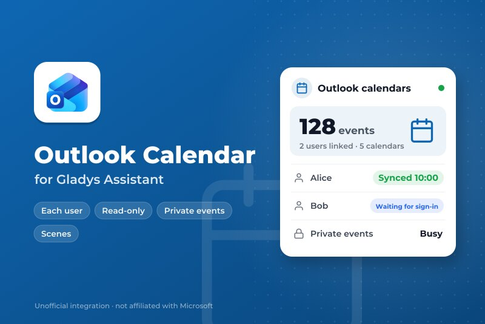
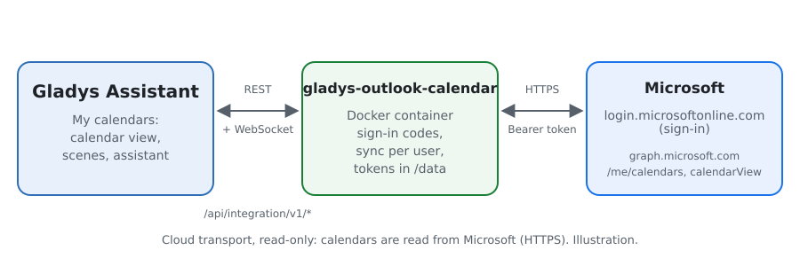
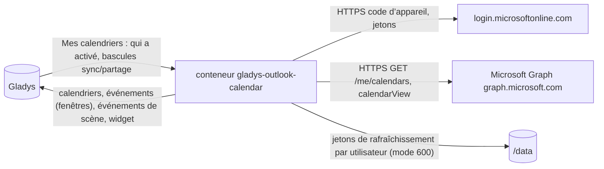
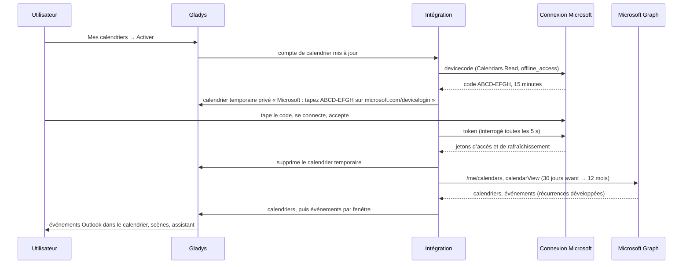
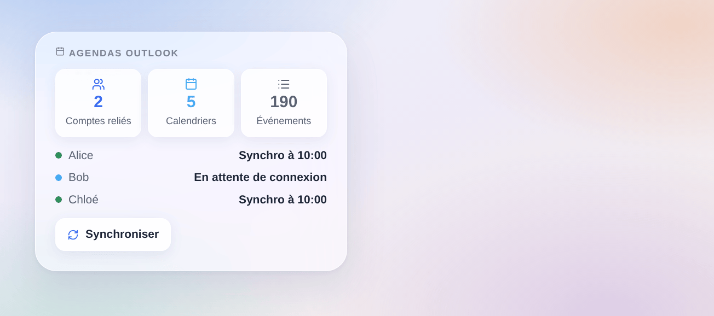

# Gladys Outlook Calendar

[English](README.md) · **Français** · [Deutsch](README.de.md) · [Español](README.es.md)

[](LICENSE)
[](https://github.com/William-De71/gladys-outlook-calendar/releases)
[](https://github.com/William-De71/gladys-outlook-calendar/actions/workflows/release.yml)
[](https://gladysassistant.com)



Intégration externe de type **calendrier** pour [Gladys Assistant](https://gladysassistant.com) qui synchronise les **calendriers Outlook** de chaque utilisateur de Gladys — Outlook.com, Hotmail ou Microsoft 365 — via Microsoft Graph, en lecture seule. Chaque utilisateur relie son propre compte Microsoft ; ses événements vivent alors dans le calendrier de Gladys, déclenchent des scènes et nourrissent l’assistant.

Documentation utilisateur : [English](docs/en.md) · [Français](docs/fr.md) · [Deutsch](docs/de.md) · [Español](docs/es.md).

Non affiliée à Microsoft. **Pas encore testée avec un vrai compte Microsoft** : les requêtes suivent les références officielles de Microsoft Graph et de la plateforme d’identité, et les tests tournent contre un faux Microsoft. Vos retours sont les bienvenus.

## Fonctionnalités

- **Fournisseur de calendriers** (`type: "calendar"`, Gladys 5.3+) : un calendrier Gladys par calendrier Outlook de chaque utilisateur, privé tant qu’il ne le partage pas ; les calendriers partagés avec lui sont inclus.
- **Chacun son compte** : connexion par utilisateur avec un code (flux « device code »), affiché dans un calendrier temporaire qui lui est propre ; jetons de rafraîchissement gardés par utilisateur, renouvelés et tournants.
- **Événements** : de 30 jours en arrière à 3, 6 ou 12 mois en avant, récurrences développées, journées entières par date, lieu, notes, lien de réunion en ligne ; un événement supprimé dans Outlook disparaît.
- **Confidentialité** : événements privés affichés « Occupé » (ou avec leurs détails, ou ignorés), invitations refusées ignorées, autorisations en lecture seule (`Calendars.Read`, `User.Read`, `offline_access`).
- **Déclencheurs de scène** : un utilisateur doit se connecter, s’est connecté, la synchro échoue, refonctionne ; **action de scène** « synchroniser maintenant ».
- **Widget de tableau de bord** : comptes reliés, calendriers et événements, l’état de chaque utilisateur, un bouton de synchro.
- Boutons **Vérifier l’inscription d’application** et **Synchroniser maintenant**. Anglais, français, allemand et espagnol.

## Fonctionnement





Relier un utilisateur, de « Mes calendriers » aux événements :



Toutes les 15 minutes (de 5 à 60), les calendriers de chaque utilisateur relié sont relus ; un calendrier dont les événements n’ont pas changé n’est pas renvoyé, et les écritures vers Gladys sont espacées (le cœur en accepte 30 par minute). Plus de 500 événements dans une fenêtre sont découpés en fenêtres disjointes, un événement à cheval sur une limite dans chacune.

**Pourquoi un calendrier temporaire** : Gladys ne propose pas encore de bouton « Connecter » par utilisateur pour les intégrations de calendrier, et le statut de connexion n’est montré qu’aux administrateurs. La propre liste de calendriers de l’utilisateur est le seul endroit privé pour lui donner son code.

### Transport

`transports: ["cloud"]` : tout passe par `login.microsoftonline.com` et `graph.microsoft.com` en HTTPS. L’intégration ne fait que lire : Gladys n’écrit jamais dans Outlook. `/data` garde un jeton de rafraîchissement par utilisateur (fichier en mode 600, jamais journalisé) ; les jetons d’accès restent en mémoire.

## Relier un compte

| Étape                                | Qui                | Où                                                                            |
| ------------------------------------ | ------------------ | ----------------------------------------------------------------------------- |
| Inscription d’application (une fois) | Administrateur     | Microsoft Entra : client public, tout type de compte, `Calendars.Read`        |
| ID d’application                     | Administrateur     | Configuration de l’intégration, puis **Vérifier l’inscription d’application** |
| Activer                              | Chaque utilisateur | Bloc **Mes calendriers** de la page Configuration                             |
| Taper le code                        | Chaque utilisateur | microsoft.com/devicelogin, le code donné par le calendrier temporaire         |

Le code se renouvelle tout seul pendant une heure (4 fois) ; au-delà, réenregistrer « Mes calendriers » en donne un nouveau. Une connexion révoquée (mot de passe changé, 90 jours sans usage) fait revenir le calendrier temporaire.

## Scènes et widget



- **Déclencheur « Outlook : un utilisateur doit se connecter »** : variables `user`, `first_name`, `reason` (`new`, `revoked`) ; filtre par raison.
- **Déclencheur « Outlook : un utilisateur s’est connecté »** : variables `user`, `first_name`, `account`.
- **Déclencheur « Outlook : la synchro échoue »** : variables `user`, `first_name`, `kind` (`app`, `forbidden`, `not_found`, `throttled`, `unreachable`, `server`), `message` ; une fois par panne et par utilisateur.
- **Déclencheur « Outlook : la synchro refonctionne »** : variables `user`, `first_name`, `down_minutes`.
- **Action « Outlook : synchroniser maintenant »** : sorties `users`, `events`.
- **Widget « Agendas Outlook »** : prénoms et états seulement, jamais d’e-mail ni d’événement (un tableau de bord est vu par toute la maison).
- Les événements eux-mêmes déclenchent des scènes avec le déclencheur Gladys « un événement de calendrier arrive », sur les calendriers partagés.

Exemples :

- _Quand un utilisateur doit se reconnecter_ (raison `revoked`) → envoyer un message Telegram à `{{triggerEvent.data.first_name}}`.
- _Chaque matin à 7 h_ → Outlook : synchroniser maintenant, puis lire les événements du jour à voix haute.

## Prérequis

- Gladys Assistant **5.3.0** ou plus récent (intégrations de calendrier) ; les instances plus anciennes ne peuvent pas installer l’intégration.
- Un compte Microsoft par utilisateur (personnel ou professionnel), et une inscription d’application dans Microsoft Entra (gratuite).

### Limites

- Microsoft Graph limite par utilisateur et par application ; un 429 attend ce que demande `Retry-After` (30 s au plus), puis la synchro de cet utilisateur échoue une fois et le déclencheur part.
- 50 calendriers par utilisateur et 10 000 événements par calendrier dans Gladys.
- Un compte professionnel peut exiger qu’un administrateur de l’entreprise approuve l’application (consentement administrateur).

## Installation

- **Depuis le store** : Intégrations → Outlook Calendar → Installer.
- **Depuis l’URL du dépôt** : Intégrations → intégration externe → `https://github.com/William-De71/gladys-outlook-calendar`.
- **Mode développeur** : lancez `npm start` avec les variables données par Gladys (voir Développement).

## Configuration

| Champ ou bouton                        | Par défaut | Rôle                                                                     |
| -------------------------------------- | ---------- | ------------------------------------------------------------------------ |
| ID d’application (client)              | —          | Obligatoire : l’inscription d’application dans Microsoft Entra           |
| Locataire (tenant)                     | common     | `common`, `consumers`, `organizations`, ou un ID ou domaine de locataire |
| Synchroniser toutes les                | 15 min     | 5, 15, 30 minutes ou 1 heure                                             |
| Événements à venir                     | 12 mois    | 3, 6 ou 12 mois ; 30 jours en arrière sont gardés                        |
| Événements privés (par utilisateur)    | Occupé     | Occupé, affichés, ou ignorés                                             |
| Invitations refusées (par utilisateur) | Ignorées   | Ignorées ou affichées                                                    |
| Vérifier l’inscription d’application   | —          | Demande un code à Microsoft avec l’application (jeté)                    |
| Synchroniser maintenant                | —          | Relit les calendriers de chaque utilisateur relié                        |

## Utilisation

1. Créez l’inscription d’application (voir [docs/fr.md](docs/fr.md#créer-linscription-dapplication)) et collez son ID ; appuyez sur **Vérifier l’inscription d’application**.
2. Chaque utilisateur active **Mes calendriers** et tape sur microsoft.com/devicelogin le code affiché dans son calendrier temporaire.
3. Partagez un calendrier avec la maison pour utiliser ses événements dans les scènes ; ajoutez le widget à un tableau de bord.

## Développement

```bash
npm install
npm test                       # node --test, un faux Microsoft sur 127.0.0.1, jamais le réseau
npm run lint                   # ESLint
npm run format:check           # Prettier
npx github:GladysAssistant/integration-store . --skip-image-check
scripts/build-cover.sh         # cover.jpg depuis docs/assets/cover.svg
docs/illustrations/render.sh   # docs/assets/widgets.<lang>.png
```

En local, le SDK lit `GLADYS_HOST_API_URL`, `GLADYS_INTEGRATION_TOKEN` et `GLADYS_INTEGRATION_SELECTOR` (donnés par Gladys en mode développeur), et l’intégration lit `TZ`. `DEBUG=gladys-integration-sdk` affiche les journaux du SDK.

Les tests couvrent la connexion (code d’appareil, interrogation, ralentissement, refus, expiration et renouvellement, rotation du jeton, révocation), Graph (pages, `Retry-After`, un 401 rafraîchi une fois), la conversion (identifiants, couleurs, journées entières, événements privés et refusés, liens), le découpage des fenêtres, les déclencheurs, le widget (`validateWidgetContent`), le manifeste, les quatre langues, le script de release, et toute l’intégration contre le faux Gladys du SDK. `test/structure.test.js` fige chaque clé stockée par les utilisateurs.

## Processus de release


Chaque fusion sur `main` lance la CI, puis calcule la version depuis les [Conventional Commits](https://www.conventionalcommits.org/) depuis le dernier tag : `feat` → mineure, `fix` / `perf` → correctif, `!` ou `BREAKING CHANGE` → majeure (une mineure sous 1.0.0) ; `docs`, `chore`, `ci`, `test`, `style`, `refactor`, `build` seuls ne publient rien. La section du changelog est générée, le tag poussé, l’image multi-architecture construite, puis `main` reçoit le commit de release, la GitHub Release est créée et un dernier job vérifie l’image publique, le validateur du store et le topic.

- Le titre de la pull request devient le commit squash, puis la ligne du changelog : écrivez-le en anglais, pour l’utilisateur (`pr-title.yml` le vérifie). N’éditez jamais `CHANGELOG.md` à la main.
- 1.0.0 est une décision : Actions → Release → Run workflow avec `release-as: 1.0.0`. `dry-run` montre la version et les notes sans rien publier.
- **Branche protégée** : la release pousse son commit sur `main` avec `GITHUB_TOKEN`. Le ruleset `protect-main` (ni suppression, ni force-push) le laisse passer ; une règle plus stricte (pull request obligatoire, status checks) demanderait d’ajouter GitHub Actions aux exceptions, ou une GitHub App.
- Après la première release, rendez public le package `ghcr.io` (Package settings → Change visibility), sinon Gladys ne peut pas le télécharger.

## Dépannage

Voir [docs/fr.md](docs/fr.md#dépannage). Signalez les problèmes avec les versions de Gladys et de l’intégration, le type de compte (personnel ou professionnel), le locataire, le code AADSTS s’il y en a un, et le message de **Vérifier l’inscription d’application**. Ne collez jamais un code ni un jeton.

## Contribuer

Issues et pull requests bienvenues, surtout de la part de personnes avec un compte professionnel Microsoft 365 : le consentement administrateur et les calendriers partagés sont les chemins les moins testés. Lancez `npm run format:check && npm run lint && npm test` avant d’ouvrir une pull request, et ne changez aucune clé stockée (voir [CLAUDE.md](CLAUDE.md)).

## Sécurité

Voir [SECURITY.md](SECURITY.md) : signalez les vulnérabilités en privé. Les jetons de rafraîchissement vivent dans `/data/accounts.json` (mode 600), les jetons d’accès en mémoire, tous envoyés uniquement à Microsoft en HTTPS ; aucun n’est jamais journalisé. Les autorisations sont en lecture seule. Le code de connexion n’est affiché que dans le calendrier privé de l’utilisateur.

## Captures à venir

Les images ci-dessus sont des illustrations, pas des captures. Les vraies captures iront dans `docs/assets/screenshots/` (PNG, 1280 × 800) : `my-calendars.png` (le bloc Mes calendriers avec le calendrier temporaire de connexion), `calendar.png` (des événements Outlook dans le calendrier de Gladys), `configuration.png` (la configuration avec Vérifier l’inscription d’application).

## Licence

[Licence Apache 2.0](LICENSE) — voir aussi [NOTICE](NOTICE). Microsoft, Outlook et Microsoft 365 sont des marques du groupe Microsoft ; ce projet n’est ni affilié à Microsoft, ni approuvé ou sponsorisé par Microsoft. Merci à la documentation et au SDK de Gladys, et à la documentation de Microsoft Graph.
