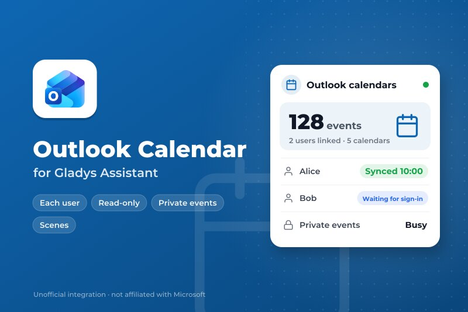
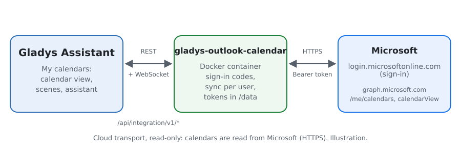
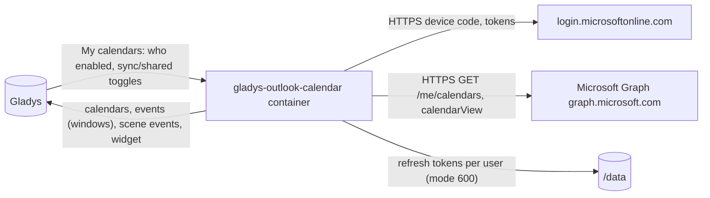
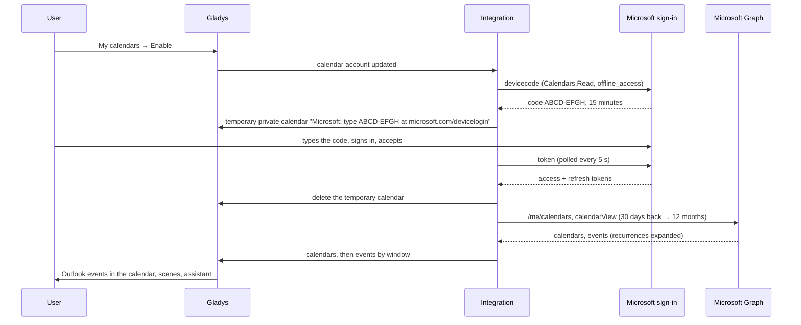
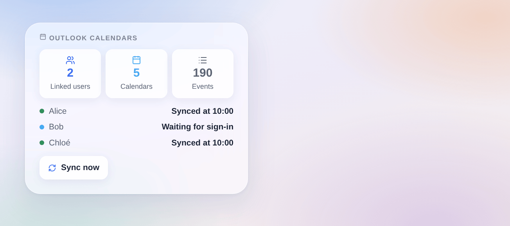

# Gladys Outlook Calendar

**English** · [Français](README.fr.md) · [Deutsch](README.de.md) · [Español](README.es.md)

[](LICENSE)
[](https://github.com/William-De71/gladys-outlook-calendar/releases)
[](https://github.com/William-De71/gladys-outlook-calendar/actions/workflows/release.yml)
[](https://gladysassistant.com)



[Gladys Assistant](https://gladysassistant.com) external integration of type **calendar** that keeps the **Outlook calendars** of each Gladys user in sync — Outlook.com, Hotmail or Microsoft 365 — through Microsoft Graph, read-only. Every user links their own Microsoft account; their events then live in the Gladys calendar, start scenes and feed the assistant.

User documentation: [English](docs/en.md) · [Français](docs/fr.md) · [Deutsch](docs/de.md) · [Español](docs/es.md).

Not affiliated with Microsoft. **Not tested with a real Microsoft account yet**: the requests follow the official Microsoft Graph and identity platform references, and the tests run against a fake Microsoft. Feedback welcome.

## Features

- **Calendar provider** (`type: "calendar"`, Gladys 5.3+): one Gladys calendar per Outlook calendar of each user, private until they share it; calendars shared with them included.
- **Each user, their own account**: per-user sign-in with a code (device code flow), shown in a temporary calendar of their own; refresh tokens kept per user, renewed and rotated.
- **Events**: 30 days back to 3, 6 or 12 months ahead, recurrences expanded, all-day events by date, place, notes, online meeting link; deleted Outlook events disappear.
- **Privacy**: private events shown as "Busy" (or with their details, or left out), declined invitations left out, read-only scopes (`Calendars.Read`, `User.Read`, `offline_access`).
- **Scene triggers**: a user must sign in, signed in, sync fails, sync works again; **scene action** "sync now".
- **Dashboard widget**: linked users, calendars and events, the state of each user, a sync button.
- **Check the app registration** and **Sync now** buttons. English, French, German and Spanish.

## How it works





Linking a user, from "My calendars" to the events:



Every 15 minutes (5 to 60), each linked user's calendars are read again; a calendar whose events did not change is not pushed again, and the writes to Gladys are spaced (the core allows 30 a minute). More than 500 events in a window are split into disjoint windows, an event across a boundary in each.

**Why a temporary calendar**: Gladys does not yet offer a per-user "Connect" button for calendar integrations, and the connection status is shown to administrators only. The user's own calendar list is the one private place to give them their code.

### Transport

`transports: ["cloud"]`: everything goes to `login.microsoftonline.com` and `graph.microsoft.com` over HTTPS. The integration only reads: Gladys never writes to Outlook. `/data` keeps one refresh token per user (file mode 600, never logged); the access tokens stay in memory.

## Linking an account

| Step                    | Who           | Where                                                                 |
| ----------------------- | ------------- | --------------------------------------------------------------------- |
| App registration (once) | Administrator | Microsoft Entra: public client, any account type, `Calendars.Read`    |
| Application ID          | Administrator | Configuration of the integration, then **Check the app registration** |
| Enable                  | Each user     | **My calendars** block of the Configuration page                      |
| Type the code           | Each user     | microsoft.com/devicelogin, the code given by the temporary calendar   |

The code is renewed on its own for an hour (4 times); after that, saving "My calendars" again gives a new one. A revoked sign-in (password changed, 90 days unused) brings the temporary calendar back.

## Scenes and widget



- **Trigger "Outlook: a user must sign in"**: variables `user`, `first_name`, `reason` (`new`, `revoked`); filter by reason.
- **Trigger "Outlook: a user signed in"**: variables `user`, `first_name`, `account`.
- **Trigger "Outlook: sync fails"**: variables `user`, `first_name`, `kind` (`app`, `forbidden`, `not_found`, `throttled`, `unreachable`, `server`), `message`; once per failure and user.
- **Trigger "Outlook: sync works again"**: variables `user`, `first_name`, `down_minutes`.
- **Action "Outlook: sync now"**: outputs `users`, `events`.
- **Widget "Outlook calendars"**: first names and states only, never an e-mail or an event (a dashboard is seen by the household).
- The events themselves start scenes with the Gladys trigger "a calendar event is coming", on shared calendars.

Examples:

- _When a user must sign in again_ (reason `revoked`) → send a Telegram message to `{{triggerEvent.data.first_name}}`.
- _Every morning at 7:00_ → Outlook: sync now, then read today's events aloud.

## Requirements

- Gladys Assistant **5.3.0** or later (calendar integrations); older instances cannot install the integration.
- A Microsoft account per user (personal or work), and one app registration in Microsoft Entra (free).

### Limits

- Microsoft Graph throttles per user and per app; a 429 waits as `Retry-After` asks (30 s at most), then the sync of that user fails once and the trigger fires.
- 50 calendars per user and 10,000 events per calendar in Gladys.
- A work account may need an administrator of the company to approve the app (admin consent).

## Installation

- **From the store**: Integrations → Outlook Calendar → Install.
- **From the repository URL**: Integrations → external integration → `https://github.com/William-De71/gladys-outlook-calendar`.
- **Developer mode**: run `npm start` with the variables given by Gladys (see Development).

## Configuration

| Field or button                 | Default   | Meaning                                                          |
| ------------------------------- | --------- | ---------------------------------------------------------------- |
| Application (client) ID         | —         | Required: the app registration in Microsoft Entra                |
| Tenant                          | common    | `common`, `consumers`, `organizations`, or a tenant ID or domain |
| Sync every                      | 15 min    | 5, 15, 30 minutes or 1 hour                                      |
| Events ahead                    | 12 months | 3, 6 or 12 months; 30 days back are kept                         |
| Private events (per user)       | Busy      | Busy, shown, or left out                                         |
| Declined invitations (per user) | Left out  | Left out or shown                                                |
| Check the app registration      | —         | Asks Microsoft for a code with the app (thrown away)             |
| Sync now                        | —         | Reads every linked user's calendars again                        |

## Usage

1. Create the app registration (see [docs/en.md](docs/en.md#create-the-app-registration)) and paste its ID; press **Check the app registration**.
2. Each user enables **My calendars** and types the code shown in their temporary calendar at microsoft.com/devicelogin.
3. Share a calendar with the household to use its events in scenes; add the widget to a dashboard.

## Development

```bash
npm install
npm test                       # node --test, a fake Microsoft on 127.0.0.1, never the network
npm run lint                   # ESLint
npm run format:check           # Prettier
npx github:GladysAssistant/integration-store . --skip-image-check
scripts/build-cover.sh         # cover.jpg from docs/assets/cover.svg
docs/illustrations/render.sh   # docs/assets/widgets.<lang>.png
```

Locally, the SDK reads `GLADYS_HOST_API_URL`, `GLADYS_INTEGRATION_TOKEN` and `GLADYS_INTEGRATION_SELECTOR` (given by Gladys in developer mode), and the integration reads `TZ`. `DEBUG=gladys-integration-sdk` shows the SDK logs.

The tests cover the sign-in (device code, polling, slow down, decline, expiry and renewal, refresh rotation, revocation), Graph (pages, `Retry-After`, a 401 refreshed once), the conversion (ids, colors, full-day dates, private and declined events, links), the window splitting, the triggers, the widget (`validateWidgetContent`), the manifest, the four languages, the release script, and the whole integration against the fake Gladys of the SDK. `test/structure.test.js` freezes every key users store.

## Release process


Every merge on `main` runs the CI, then computes the version from the [Conventional Commits](https://www.conventionalcommits.org/) since the last tag: `feat` → minor, `fix` / `perf` → patch, `!` or `BREAKING CHANGE` → major (a minor below 1.0.0); `docs`, `chore`, `ci`, `test`, `style`, `refactor`, `build` alone publish nothing. The changelog section is generated, the tag pushed, the multi-architecture image built, then `main` receives the release commit, the GitHub Release is created and a last job checks the public image, the store validator and the topic.

- The pull request title becomes the squash commit, then the changelog line: write it in English, for the user (`pr-title.yml` checks it). Never edit `CHANGELOG.md` by hand.
- 1.0.0 is a decision: Actions → Release → Run workflow with `release-as: 1.0.0`. `dry-run` shows the version and the notes without publishing.
- **Protected branch**: the release pushes its commit to `main` with `GITHUB_TOKEN`. The `protect-main` ruleset (no deletion, no force-push) lets it through; a stricter rule (pull request required, status checks) would need GitHub Actions in its bypass list, or a GitHub App.
- After the first release, make the `ghcr.io` package public (Package settings → Change visibility), or Gladys cannot pull it.

## Troubleshooting

See [docs/en.md](docs/en.md#troubleshooting). Report issues with the versions of Gladys and of the integration, the account type (personal or work), the tenant, the AADSTS code if any, and the message of **Check the app registration**. Never paste a code or a token.

## Contributing

Issues and pull requests are welcome, especially from people with a Microsoft 365 work account: the admin consent and shared calendars are the least tested paths. Run `npm run format:check && npm run lint && npm test` before opening a pull request, and keep every stored key unchanged (see [CLAUDE.md](CLAUDE.md)).

## Security

See [SECURITY.md](SECURITY.md): report vulnerabilities privately. Refresh tokens live in `/data/accounts.json` (mode 600), access tokens in memory, both sent only to Microsoft over HTTPS; neither is ever logged. The scopes are read-only. The sign-in code is shown only in the user's own private calendar.

## Screenshots to come

The images above are illustrations, not screenshots. Real screenshots will go in `docs/assets/screenshots/` (PNG, 1280 × 800): `my-calendars.png` (the My calendars block with the temporary sign-in calendar), `calendar.png` (Outlook events in the Gladys calendar), `configuration.png` (the configuration with Check the app registration).

## License

[Apache License 2.0](LICENSE) — see also [NOTICE](NOTICE). Microsoft, Outlook and Microsoft 365 are trademarks of the Microsoft group of companies; this project is not affiliated with, endorsed or sponsored by Microsoft. Thanks to the Gladys documentation and SDK, and to the Microsoft Graph documentation.
