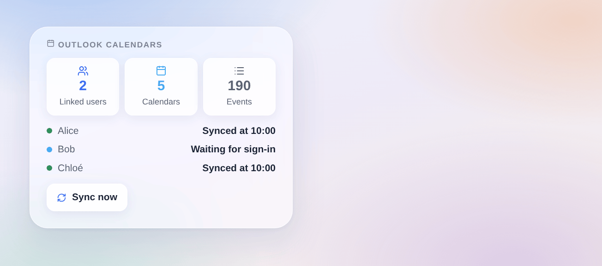

# Outlook Calendar

## Overview

This integration brings your **Outlook calendars** into Gladys — Outlook.com, Hotmail, Live or Microsoft 365 — through the official Microsoft Graph API, read-only. **Each Gladys user links their own Microsoft account**: their calendars stay theirs, private until they share them with the household. Events then appear in the Gladys calendar, start scenes with the "an event is coming" trigger, and the assistant can read them.

Recurring events, all-day events, calendars shared with you and online meeting links are handled. Private events can be shown as "Busy" or left out, and declined invitations are left out by default.

Not affiliated with Microsoft. Not tested with a real Microsoft account yet: feedback welcome.

## Prerequisites

- Gladys Assistant 5.3.0 or later.
- A Microsoft account with a calendar: personal (Outlook.com, Hotmail, Live) or work (Microsoft 365).
- Once, for the whole home: a free **app registration** in Microsoft Entra, made by the administrator of Gladys (any Microsoft account can create one).
- **Your data**: every user's calendar events are read by Gladys from Microsoft; nothing is ever written to Outlook.

### Create the app registration

1. Go to [portal.azure.com](https://portal.azure.com) → **Microsoft Entra ID** → **App registrations** → **New registration** (a personal Microsoft account works).
2. Name: `Gladys`. Supported account types: **Accounts in any organizational directory and personal Microsoft accounts**. Redirect URI: leave empty. **Register**.
3. **Authentication** → **Advanced settings** → **Allow public client flows**: **Yes** → **Save**.
4. **API permissions** → **Add a permission** → **Microsoft Graph** → **Delegated permissions**: `Calendars.Read`, `User.Read`, `offline_access` → **Add permissions**.
5. Copy the **Application (client) ID** from the **Overview** page.

No client secret, no redirect address: users sign in with a code, from any device.

## Configuration

| Field or button (administrator) | Default    | Meaning                                                                                 |
| ------------------------------- | ---------- | --------------------------------------------------------------------------------------- |
| Application (client) ID         | —          | Required: the ID of your app registration                                               |
| Tenant                          | common     | `common` for personal and work accounts, `consumers` for personal only, or your company |
| Sync every                      | 15 minutes | 5, 15, 30 minutes or 1 hour                                                             |
| Events ahead                    | 12 months  | 3, 6 or 12 months; the last 30 days are kept too                                        |
| Check the app registration      | —          | Asks Microsoft whether the app accepts sign-ins, and says what is wrong if not          |
| Sync now                        | —          | Reads every linked user's calendars again                                               |

| Field (each user, "My calendars") | Default         | Meaning                                                                     |
| --------------------------------- | --------------- | --------------------------------------------------------------------------- |
| Private events                    | Shown as "Busy" | Shown as "Busy" (no title, no place), shown with their details, or left out |
| Declined invitations              | Left out        | Left out or shown                                                           |

## Usage

1. The administrator: Integrations → **Outlook Calendar** → Configuration: paste the application ID, save, press **Check the app registration**.
2. Each user: the same page, **My calendars** block → **Enable**.
3. Their calendars arrive, private; each one can be turned off or shared with the household from the same block.

### Linking your account

Gladys does not yet have a "Connect" button per user, so the sign-in code comes in **a temporary calendar**, in your "My calendars" list (and as an event in your calendar view), named for instance:

> Microsoft: type ABCD-EFGH at microsoft.com/devicelogin

Open [microsoft.com/devicelogin](https://microsoft.com/devicelogin) on any computer or phone, type the code, sign in with your Microsoft account and accept the permissions (read your calendars, keep access). Within a few seconds the temporary calendar disappears and your Outlook calendars appear. The code is valid about 15 minutes and is renewed on its own for an hour; after that, save "My calendars" again to get a new one.

To link another Microsoft account, disable "My calendars" and enable it again. If Microsoft stops accepting the sign-in (password changed, access removed, 90 days unused), the temporary calendar comes back with a new code.

### Dashboard widget

The **Outlook calendars** widget shows how many users are linked, the calendars and events synchronized, and one row per user who enabled "My calendars": synced at what time, waiting for sign-in, or an error. Only first names: no e-mail, no event. A button syncs now.

### Scenes

The events themselves start scenes with the Gladys trigger **"A calendar event is coming"** (on shared calendars). The integration adds:

- **Trigger "Outlook: a user must sign in"**: a user enabled "My calendars" (`new`) or Microsoft no longer accepts their sign-in (`revoked`), with their first name.
- **Trigger "Outlook: a user signed in"**: with their first name and Microsoft account.
- **Trigger "Outlook: sync fails"**: once per failure and user (access denied, no mailbox, throttled, Microsoft unreachable, Microsoft error).
- **Trigger "Outlook: sync works again"**: with the minutes of failure.
- **Action "Outlook: sync now"**: before a scene that looks at today's events.

Examples: when a user must sign in again (`revoked`), send them a Telegram message "Your Outlook link expired, look at My calendars"; every morning at 7:00, sync now, then read today's events aloud.

## Troubleshooting

- **"Microsoft refuses the app registration: AADSTS700016"**: the application ID is wrong, or the app was deleted.
- **"AADSTS7000218"** or a client secret asked: **Allow public client flows** is not set to Yes (step 3).
- **"AADSTS50020"** or **"AADSTS9002331"**: the account types of the app do not match the tenant: choose "any organizational directory and personal Microsoft accounts", or set the tenant to `consumers` (personal only) or your company domain (work only).
- **No temporary calendar after enabling**: refresh the page; if the administrator has not entered the application ID yet, the temporary calendar says so.
- **"Code expired, save My calendars again"**: nobody signed in for an hour: save "My calendars" for a new code.
- **A work account is refused**: your company may require an administrator to approve the app (admin consent) in Microsoft Entra.
- **A shared calendar has no events**: the person who shared it may only share free/busy times; a calendar Microsoft refuses to read is skipped.
- Logs: Settings → Supervision, the logs of the integration. Never share a code or a token.
