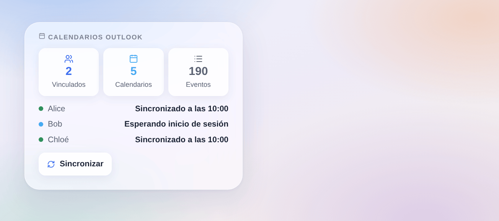

# Outlook Calendar

## Presentación

Esta integración lleva sus **calendarios de Outlook** a Gladys — Outlook.com, Hotmail, Live o Microsoft 365 — a través de la API oficial Microsoft Graph, en solo lectura. **Cada usuario de Gladys vincula su propia cuenta de Microsoft**: sus calendarios siguen siendo suyos, privados hasta que los comparta con el hogar. Los eventos aparecen entonces en el calendario de Gladys, disparan escenas con «se acerca un evento», y el asistente puede leerlos.

Se gestionan los eventos periódicos, los de día completo, los calendarios compartidos con usted y los enlaces de reuniones en línea. Los eventos privados pueden mostrarse como «Ocupado» u omitirse, y las invitaciones rechazadas se omiten por defecto.

No afiliada a Microsoft. Todavía no probada con una cuenta real de Microsoft: sus comentarios son bienvenidos.

## Requisitos previos

- Gladys Assistant 5.3.0 o posterior.
- Una cuenta de Microsoft con calendario: personal (Outlook.com, Hotmail, Live) o profesional (Microsoft 365).
- Una sola vez, para toda la casa: un **registro de aplicación** gratuito en Microsoft Entra, hecho por el administrador de Gladys (cualquier cuenta de Microsoft puede crear uno).
- **Sus datos**: Gladys lee en Microsoft los eventos de cada usuario; nunca se escribe nada en Outlook.

### Crear el registro de aplicación

1. Vaya a [portal.azure.com](https://portal.azure.com) → **Microsoft Entra ID** → **Registros de aplicaciones** → **Nuevo registro** (basta una cuenta personal de Microsoft).
2. Nombre: `Gladys`. Tipos de cuenta admitidos: **Cuentas en cualquier directorio organizativo y cuentas personales de Microsoft**. URI de redirección: déjelo vacío. **Registrar**.
3. **Autenticación** → **Configuración avanzada** → **Permitir flujos de clientes públicos**: **Sí** → **Guardar**.
4. **Permisos de API** → **Agregar un permiso** → **Microsoft Graph** → **Permisos delegados**: `Calendars.Read`, `User.Read`, `offline_access` → **Agregar permisos**.
5. Copie el **ID de aplicación (cliente)** desde la página **Información general**.

Sin secreto de cliente ni dirección de redirección: los usuarios inician sesión con un código, desde cualquier dispositivo.

## Configuración

| Campo o botón (administrador)       | Por defecto | Función                                                                                          |
| ----------------------------------- | ----------- | ------------------------------------------------------------------------------------------------ |
| ID de aplicación (cliente)          | —           | Obligatorio: el ID de su registro de aplicación                                                  |
| Inquilino (tenant)                  | common      | `common` para cuentas personales y profesionales, `consumers` solo para personales, o su empresa |
| Sincronizar cada                    | 15 minutos  | 5, 15, 30 minutos o 1 hora                                                                       |
| Eventos por delante                 | 12 meses    | 3, 6 o 12 meses; también se conservan los últimos 30 días                                        |
| Comprobar el registro de aplicación | —           | Pregunta a Microsoft si la aplicación acepta inicios de sesión y, si no, dice qué falla          |
| Sincronizar ahora                   | —           | Vuelve a leer los calendarios de cada usuario vinculado                                          |

| Campo (cada usuario, «Mis calendarios») | Por defecto              | Función                                                                      |
| --------------------------------------- | ------------------------ | ---------------------------------------------------------------------------- |
| Eventos privados                        | Mostrados como «Ocupado» | Mostrados como «Ocupado» (sin título ni lugar), con sus detalles, u omitidos |
| Invitaciones rechazadas                 | Omitidas                 | Omitidas o mostradas                                                         |

## Uso

1. El administrador: Integraciones → **Outlook Calendar** → Configuración: pegue el ID de aplicación, guarde, pulse **Comprobar el registro de aplicación**.
2. Cada usuario: la misma página, bloque **Mis calendarios** → **Activar**.
3. Sus calendarios llegan, privados; cada uno puede desactivarse o compartirse con el hogar desde el mismo bloque.

### Vincular su cuenta

Gladys todavía no tiene un botón «Conectar» por usuario, así que el código de inicio de sesión llega en **un calendario temporal**, en su lista «Mis calendarios» (y como evento en su vista de calendario), con un nombre como:

> Microsoft: escriba ABCD-EFGH en microsoft.com/devicelogin

Abra [microsoft.com/devicelogin](https://microsoft.com/devicelogin) en cualquier ordenador o teléfono, escriba el código, inicie sesión con su cuenta de Microsoft y acepte los permisos (leer sus calendarios, mantener el acceso). En unos segundos, el calendario temporal desaparece y aparecen sus calendarios de Outlook. El código vale unos 15 minutos y se renueva solo durante una hora; después, guarde de nuevo «Mis calendarios» para obtener uno nuevo.

Para vincular otra cuenta de Microsoft, desactive «Mis calendarios» y vuelva a activarlo. Si Microsoft deja de aceptar el inicio de sesión (contraseña cambiada, acceso retirado, 90 días sin uso), el calendario temporal vuelve con un código nuevo.

### Widget del panel

El widget **Calendarios Outlook** muestra cuántos usuarios están vinculados, los calendarios y eventos sincronizados, y una fila por usuario que ha activado «Mis calendarios»: sincronizado a qué hora, esperando inicio de sesión o con error. Solo nombres de pila: ni correo ni evento. Un botón sincroniza en el momento.

### Escenas

Los propios eventos disparan escenas con el disparador de Gladys **«Se acerca un evento del calendario»** (en los calendarios compartidos). La integración añade:

- **Disparador «Outlook: un usuario debe iniciar sesión»**: un usuario ha activado «Mis calendarios» (`new`) o Microsoft ya no acepta su inicio de sesión (`revoked`), con su nombre.
- **Disparador «Outlook: un usuario ha iniciado sesión»**: con su nombre y su cuenta de Microsoft.
- **Disparador «Outlook: la sincronización falla»**: una vez por fallo y usuario (acceso denegado, sin buzón, limitado, Microsoft inaccesible, error de Microsoft).
- **Disparador «Outlook: la sincronización vuelve a funcionar»**: con los minutos de fallo.
- **Acción «Outlook: sincronizar ahora»**: antes de una escena que mira los eventos del día.

Ejemplos: cuando un usuario debe volver a iniciar sesión (`revoked`), enviarle un mensaje de Telegram «Tu vínculo de Outlook ha caducado, mira Mis calendarios»; cada mañana a las 7:00, sincronizar ahora y luego leer en voz alta los eventos del día.

## Solución de problemas

- **«Microsoft rechaza el registro de aplicación: AADSTS700016»**: el ID de aplicación es incorrecto, o la aplicación se ha eliminado.
- **«AADSTS7000218»** o se pide un secreto de cliente: **Permitir flujos de clientes públicos** no está en Sí (paso 3).
- **«AADSTS50020»** o **«AADSTS9002331»**: los tipos de cuenta de la aplicación no coinciden con el inquilino: elija «cualquier directorio organizativo y cuentas personales de Microsoft», o ponga el inquilino en `consumers` (solo personales) o el dominio de su empresa (solo profesionales).
- **No aparece el calendario temporal tras activar**: recargue la página; si el administrador aún no ha introducido el ID de aplicación, el calendario temporal lo indica.
- **«Código caducado, guarde Mis calendarios de nuevo»**: nadie ha iniciado sesión en una hora: guarde «Mis calendarios» para obtener un código nuevo.
- **Se rechaza una cuenta profesional**: puede que su empresa exija que un administrador apruebe la aplicación (consentimiento del administrador) en Microsoft Entra.
- **Un calendario compartido no tiene eventos**: quizá la persona que lo compartió solo comparte la disponibilidad; un calendario que Microsoft no deja leer se omite.
- Registros: Ajustes → Supervisión, los registros de la integración. Nunca comparta un código ni un token.
